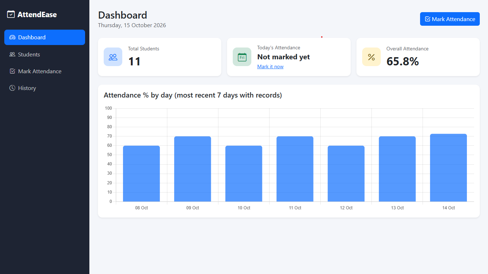
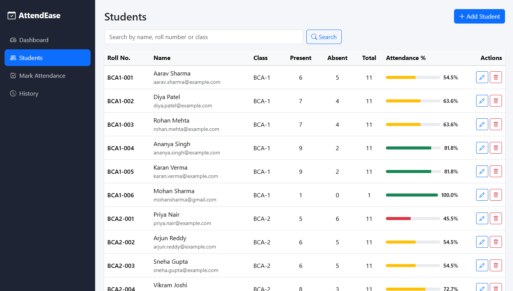
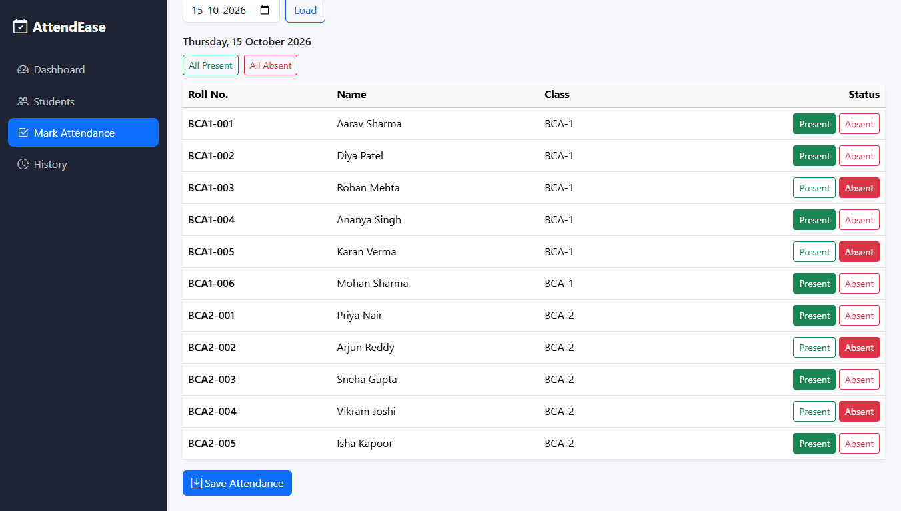
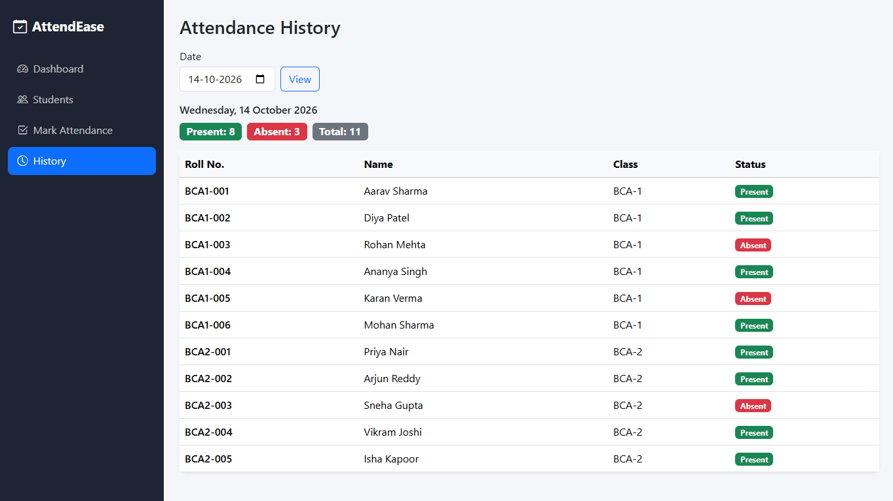

# AttendEase: Student Attendance Management System

A web app for managing student records and tracking daily attendance, built with Flask and MySQL.



## Features

- **Dashboard** with total students, today's attendance and overall attendance percentage
- **Student management:** add, edit, delete and search students
- **Mark attendance** (Present/Absent) for any past or current date
- **No duplicate records:** a database UNIQUE constraint on (student, date) guarantees one record per student per day
- **Attendance history** viewable by date
- **Per-student statistics:** present, absent, total days and attendance percentage
- Responsive Bootstrap 5 interface with sidebar navigation

## Tech Stack

- **Backend:** Python, Flask
- **Database:** MySQL (primary/foreign keys, unique constraints, parameterized queries)
- **Frontend:** HTML, CSS, Bootstrap 5, Jinja2, Chart.js

## Screenshots

| Students | Mark Attendance | History |
|---|---|---|
|  |  |  |

## Database Design

- `students` (student_id PK, roll_number UNIQUE, full_name, email UNIQUE, class_name)
- `attendance` (attendance_id PK, student_id FK, attendance_date, status, UNIQUE (student_id, attendance_date))

Attendance percentage is calculated from the records (present days ÷ total recorded days × 100) and never stored.

## Setup (Windows)

**Requirements:** Python 3.9+, MySQL Server 8.x, Git.

1. Clone the repository and open it in VS Code:
```
   git clone [your-repo-url]
   cd attendease
```
2. Create a virtual environment and install packages:
```
   python -m venv venv
   venv\Scripts\Activate.ps1
   pip install -r requirements.txt
```
3. Create the database, tables and sample data. **Warning:** this resets the attendance tables.
```
   mysql -u root -p -e "source schema.sql"
```
4. Create a limited MySQL user (choose your own password):
```sql
   CREATE USER 'attendease_user'@'localhost' IDENTIFIED BY 'your_password';
   GRANT SELECT, INSERT, UPDATE, DELETE ON attendease.* TO 'attendease_user'@'localhost';
```
5. Create your `.env` file and fill in the values:
```
   copy .env.example .env
```
6. Run the app and open http://127.0.0.1:5000:
```
   python -m flask --app app run --debug
```

## Testing Checklist

1. Dashboard shows student count, today's attendance and overall percentage.
2. Add a student; try a duplicate roll number or email and confirm you get an error.
3. Edit, search and delete a student.
4. Mark attendance for today, then save again and confirm it updates instead of duplicating.
5. Open History and pick a date to see its records.
6. Check each student's percentage on the Students page.

## Known Limitations

- No user login or roles
- No CSRF protection (Flask-WTF would add it)
- Not configured for production deployment (runs in debug mode locally)

## Future Improvements

- Login for teachers and admins
- CSV export of attendance reports
- Per-student attendance detail page

## Security

Secrets live in `.env`, which is excluded by `.gitignore`. Never commit it. All SQL uses parameterized queries.